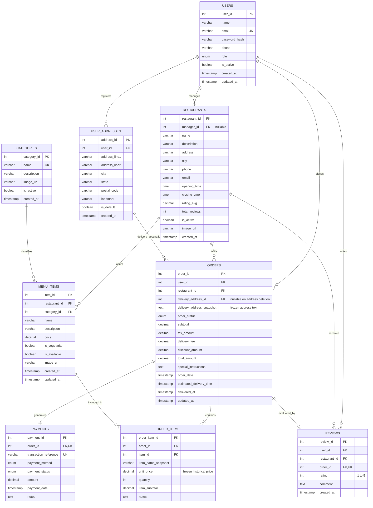

# Online Food Ordering System — DBMS Capstone Project
## Phase 1: Requirements, System Architecture, ER Design & Relational Schema

---

## 1. Executive Summary & Project Objectives

The **Online Food Ordering System** is a centralized, relational database-backed enterprise web application designed to model modern on-demand food delivery platforms (such as DoorDash, Uber Eats, or Zomato).

The core technical purpose of this project is to demonstrate **core Database Management System (DBMS) principles** in a realistic full-stack software environment:
- **Relational Integrity & 3NF Normalization**: Eliminating redundant data anomalies, enforcing referential integrity with cascading rules.
- **Transactional Consistency (ACID)**: Atomically processing order creation, payment state transitions, and price snapshotting via explicit MySQL database transactions.
- **Historical Immutability**: Freezing historical prices and delivery addresses at the moment of order placement to maintain financial and legal integrity regardless of future menu or user address changes.
- **Role-Based Authorization & Auditing**: Strict separation between Customer, Restaurant Manager, and Administrator domains enforced server-side.
- **Rich Analytics & Indexing**: Executing multi-table joins, aggregations, window functions, and views for operational analytics.

---

## 2. Requirements & Scope Analysis

### 2.1 User Roles & Permissions

| Role | Responsibilities & Capabilities |
| :--- | :--- |
| **Customer** | • User registration, credential authentication (bcrypt + JWT/Session).<br>• Manage multiple delivery addresses (with one marked default).<br>• Search & filter restaurants by cuisine, category, price, veg/non-veg status.<br>• Cart management (enforcing single-restaurant order constraints).<br>• Atomic order placement with server-validated pricing.<br>• View real-time order status lifecycle and detailed past order receipts.<br>• Cancel orders strictly within valid states (`PENDING`, `CONFIRMED`).<br>• Submit ratings (1–5) and reviews for eligible delivered orders. |
| **Administrator** | • Full system oversight & administrative dashboard.<br>• Onboard, modify, and deactivate restaurants.<br>• Manage global food categories and system-wide menu taxonomies.<br>• Oversee customer accounts, block suspicious actors.<br>• View all platform orders with master status override capabilities.<br>• Access financial and sales analytics (daily/monthly revenue, top-selling items, top-spending customers). |
| **Restaurant Manager** *(Scoped Role)* | • Manage catalog and menu items for assigned restaurant(s).<br>• Toggle item availability (in-stock vs sold-out) and adjust base prices.<br>• Monitor active incoming orders specifically assigned to their restaurant.<br>• Advance order preparation workflow (`CONFIRMED` -> `PREPARING` -> `OUT_FOR_DELIVERY`). |

### 2.2 Functional Requirements

1. **Authentication & Identity**:
   - Secure account registration with email uniqueness constraint and cryptographic password hashing (`bcrypt`, salt rounds = 10).
   - Role-based access control (RBAC) middleware verifying token claims before executing sensitive mutations.
2. **Catalog & Search Navigation**:
   - Multi-criteria filtering: search queries matching item name or description, category filtering, restaurant selection, price range, and vegetarian flag.
   - Server-side pagination and indexing on high-cardinality search fields (`restaurant_id`, `category_id`, `is_available`).
3. **Cart & Order Integrity**:
   - **Single Restaurant Invariant**: A food delivery order must originate from a single restaurant to prevent distributed logistics failures. The backend rejects mixed-restaurant cart checkouts.
   - **Server-Side Price Calculation**: Client-side prices are treated as untrusted hints. The backend executes a parameterized query to fetch current database prices, calculates subtotal, tax rate (e.g., 5%), and delivery fee, and asserts all computations inside a transactional boundary.
   - **Historical Snapshotting**: The `order_items` record explicitly copies `unit_price` at the instant of order creation. Future price fluctuations in `menu_items` will never corrupt historical receipts.
4. **Order Lifecycle State Machine**:
   - Permitted states: `PENDING` $\to$ `CONFIRMED` $\to$ `PREPARING` $\to$ `OUT_FOR_DELIVERY` $\to$ `DELIVERED`.
   - Terminal states: `DELIVERED`, `CANCELLED`.
   - Customer cancellations are only permitted when state is `PENDING` or `CONFIRMED`. Once `PREPARING`, cancellation is rejected.
5. **Payment Decoupling**:
   - Order status is decoupled from payment status (`PENDING`, `COMPLETED`, `FAILED`, `REFUNDED`). An order is only confirmed when payment state is validated or marked as Cash-on-Delivery (`COD`).

### 2.3 Non-Functional Requirements
- **ACID Compliance**: All multi-step mutations (order header + order items insertion + address verification) run inside an explicit `START TRANSACTION ... COMMIT / ROLLBACK` block on MySQL InnoDB.
- **Zero SQL Injection**: 100% parameterized queries using MySQL prepared statements. No string interpolation in SQL clauses.
- **Data Integrity Constraints**: Native MySQL `CHECK` constraints (e.g., `rating BETWEEN 1 AND 5`, `quantity > 0`, `price >= 0.00`).
- **Auditability**: `created_at` and `updated_at` timestamps on all transactional and master tables.

---

## 3. System Architecture

The project employs a robust 3-Tier Layered Architecture:

```
+-----------------------------------------------------------------------+
|                           PRESENTATION TIER                           |
|      React 18 + Vite | Tailwind CSS | React Router | Context API      |
|  - Customer Portal (Catalog, Cart, Checkout, Order Tracking, Reviews) |
|  - Admin & Manager Dashboard (Metrics, Restaurant & Menu CRUD, Orders)|
+-----------------------------------------------------------------------+
                                   |
                             REST APIs / JSON
                         (Bearer JWT Auth Header)
                                   v
+-----------------------------------------------------------------------+
|                           APPLICATION TIER                            |
|                       Node.js + Express.js                            |
|  [Middleware]: CORS, Rate Limiting, JWT Auth, RBAC Guard, Validator   |
|  [Controllers & Services]: Auth, Restaurant, Menu, Cart, Order, Admin |
|  [Data Access Layer]: mysql2/promise Connection Pool & Transactions   |
+-----------------------------------------------------------------------+
                                   |
                         Parameterized SQL / ACID
                                   v
+-----------------------------------------------------------------------+
|                            DATABASE TIER                              |
|                          MySQL 8.0 (InnoDB)                           |
|  - Normalized Relational Tables (PK/FK Constraints, Cascade Rules)    |
|  - Indexes (B-Tree on foreign keys & composite search indexes)        |
|  - Views for Reporting & Analytics                                    |
|  - Stored Procedures / Triggers for audit and state safety            |
+-----------------------------------------------------------------------+
```

---

## 4. Architectural Decision: Unified Users Table vs. Separate Tables

### Selection: **Unified `users` Table with Role-Based Polymorphism**

| Metric | Unified `users` Table (Selected) | Separate `customers` and `admins` Tables |
| :--- | :--- | :--- |
| **Authentication Flow** | Single `/api/auth/login` and `/api/auth/register` pipeline. Consistent JWT signing and token verification. | Requires duplicated authentication controllers, separate token schemas, and distinct login endpoints. |
| **Foreign Key Simplicity** | Auditing, reviews, orders, and addresses cleanly reference `users(user_id)`. | Requires nullable composite foreign keys or polymorphic associations, violating relational purity. |
| **Role Evolution** | A user can be promoted to restaurant manager or admin via a simple role update without data migration across tables. | Requires deleting rows from one table and inserting into another, breaking historical foreign key integrity. |
| **Security Isolation** | Enforced strictly at the server middleware layer (`authorize('admin')`). Role cannot be manipulated by client payload. | Physical isolation exists, but at the cost of duplicate database indexes, constraints, and code maintenance. |

**Conclusion**: We adopt the unified `users` table design with an `enum('customer', 'admin', 'restaurant_manager')` role column. For role-specific operational data (such as restaurant manager assignment), a clean foreign key relationship connects `restaurants.manager_id` to `users.user_id`.

---

## 5. Entity-Relationship (ER) Model



---

## 6. Relational Schema Specification (Targeting 3NF)

### 6.1 `users`
Represents all system actors (customers, admins, restaurant managers).
- `user_id`: `INT UNSIGNED AUTO_INCREMENT PRIMARY KEY`
- `name`: `VARCHAR(100) NOT NULL`
- `email`: `VARCHAR(150) NOT NULL UNIQUE`
- `password_hash`: `VARCHAR(255) NOT NULL` (Bcrypt hash)
- `phone`: `VARCHAR(20) NOT NULL`
- `role`: `ENUM('customer', 'admin', 'restaurant_manager') NOT NULL DEFAULT 'customer'`
- `is_active`: `BOOLEAN NOT NULL DEFAULT TRUE`
- `created_at`: `TIMESTAMP NOT NULL DEFAULT CURRENT_TIMESTAMP`
- `updated_at`: `TIMESTAMP NOT NULL DEFAULT CURRENT_TIMESTAMP ON UPDATE CURRENT_TIMESTAMP`

### 6.2 `user_addresses`
Stores normalized physical delivery addresses associated with customers.
- `address_id`: `INT UNSIGNED AUTO_INCREMENT PRIMARY KEY`
- `user_id`: `INT UNSIGNED NOT NULL`
  - `FOREIGN KEY (user_id) REFERENCES users(user_id) ON DELETE CASCADE ON UPDATE CASCADE`
- `address_line1`: `VARCHAR(255) NOT NULL`
- `address_line2`: `VARCHAR(255) NULL`
- `city`: `VARCHAR(100) NOT NULL`
- `state`: `VARCHAR(100) NOT NULL`
- `postal_code`: `VARCHAR(20) NOT NULL`
- `landmark`: `VARCHAR(150) NULL`
- `is_default`: `BOOLEAN NOT NULL DEFAULT FALSE`
- `created_at`: `TIMESTAMP NOT NULL DEFAULT CURRENT_TIMESTAMP`

### 6.3 `restaurants`
Stores restaurant profiles, operating hours, and operational status.
- `restaurant_id`: `INT UNSIGNED AUTO_INCREMENT PRIMARY KEY`
- `manager_id`: `INT UNSIGNED NULL`
  - `FOREIGN KEY (manager_id) REFERENCES users(user_id) ON DELETE SET NULL ON UPDATE CASCADE`
- `name`: `VARCHAR(150) NOT NULL`
- `description`: `TEXT NULL`
- `address`: `VARCHAR(255) NOT NULL`
- `city`: `VARCHAR(100) NOT NULL`
- `phone`: `VARCHAR(20) NOT NULL`
- `email`: `VARCHAR(150) NOT NULL`
- `opening_time`: `TIME NOT NULL`
- `closing_time`: `TIME NOT NULL`
- `rating_avg`: `DECIMAL(3, 2) NOT NULL DEFAULT 0.00`
- `total_reviews`: `INT UNSIGNED NOT NULL DEFAULT 0`
- `is_active`: `BOOLEAN NOT NULL DEFAULT TRUE`
- `image_url`: `VARCHAR(500) NULL`
- `created_at`: `TIMESTAMP NOT NULL DEFAULT CURRENT_TIMESTAMP`

### 6.4 `categories`
Global master classification of food items (e.g., Starters, Main Course, Beverages, Desserts).
- `category_id`: `INT UNSIGNED AUTO_INCREMENT PRIMARY KEY`
- `name`: `VARCHAR(100) NOT NULL UNIQUE`
- `description`: `TEXT NULL`
- `image_url`: `VARCHAR(500) NULL`
- `is_active`: `BOOLEAN NOT NULL DEFAULT TRUE`
- `created_at`: `TIMESTAMP NOT NULL DEFAULT CURRENT_TIMESTAMP`

### 6.5 `menu_items`
Catalog of food items offered by restaurants.
- `item_id`: `INT UNSIGNED AUTO_INCREMENT PRIMARY KEY`
- `restaurant_id`: `INT UNSIGNED NOT NULL`
  - `FOREIGN KEY (restaurant_id) REFERENCES restaurants(restaurant_id) ON DELETE CASCADE ON UPDATE CASCADE`
- `category_id`: `INT UNSIGNED NOT NULL`
  - `FOREIGN KEY (category_id) REFERENCES categories(category_id) ON DELETE RESTRICT ON UPDATE CASCADE`
- `name`: `VARCHAR(150) NOT NULL`
- `description`: `TEXT NULL`
- `price`: `DECIMAL(10, 2) NOT NULL`
  - `CONSTRAINT chk_menu_item_price CHECK (price >= 0.00)`
- `is_vegetarian`: `BOOLEAN NOT NULL DEFAULT FALSE`
- `is_available`: `BOOLEAN NOT NULL DEFAULT TRUE`
- `image_url`: `VARCHAR(500) NULL`
- `created_at`: `TIMESTAMP NOT NULL DEFAULT CURRENT_TIMESTAMP`
- `updated_at`: `TIMESTAMP NOT NULL DEFAULT CURRENT_TIMESTAMP ON UPDATE CURRENT_TIMESTAMP`

### 6.6 `orders`
The master record for customer food delivery transactions.
- `order_id`: `INT UNSIGNED AUTO_INCREMENT PRIMARY KEY`
- `user_id`: `INT UNSIGNED NOT NULL`
  - `FOREIGN KEY (user_id) REFERENCES users(user_id) ON DELETE RESTRICT ON UPDATE CASCADE`
- `restaurant_id`: `INT UNSIGNED NOT NULL`
  - `FOREIGN KEY (restaurant_id) REFERENCES restaurants(restaurant_id) ON DELETE RESTRICT ON UPDATE CASCADE`
- `delivery_address_id`: `INT UNSIGNED NULL`
  - `FOREIGN KEY (delivery_address_id) REFERENCES user_addresses(address_id) ON DELETE SET NULL ON UPDATE CASCADE`
- `delivery_address_snapshot`: `TEXT NOT NULL` *(Address string preserved immutably)*
- `order_status`: `ENUM('PENDING', 'CONFIRMED', 'PREPARING', 'OUT_FOR_DELIVERY', 'DELIVERED', 'CANCELLED') NOT NULL DEFAULT 'PENDING'`
- `subtotal`: `DECIMAL(10, 2) NOT NULL`
- `tax_amount`: `DECIMAL(10, 2) NOT NULL DEFAULT 0.00`
- `delivery_fee`: `DECIMAL(10, 2) NOT NULL DEFAULT 0.00`
- `discount_amount`: `DECIMAL(10, 2) NOT NULL DEFAULT 0.00`
- `total_amount`: `DECIMAL(10, 2) NOT NULL`
  - `CONSTRAINT chk_order_total CHECK (total_amount >= 0.00)`
- `special_instructions`: `TEXT NULL`
- `order_date`: `TIMESTAMP NOT NULL DEFAULT CURRENT_TIMESTAMP`
- `estimated_delivery_time`: `TIMESTAMP NULL`
- `delivered_at`: `TIMESTAMP NULL`
- `updated_at`: `TIMESTAMP NOT NULL DEFAULT CURRENT_TIMESTAMP ON UPDATE CURRENT_TIMESTAMP`

### 6.7 `order_items`
Junction table resolving the Many-to-Many relationship between `orders` and `menu_items`. Captures historical prices and item counts.
- `order_item_id`: `INT UNSIGNED AUTO_INCREMENT PRIMARY KEY`
- `order_id`: `INT UNSIGNED NOT NULL`
  - `FOREIGN KEY (order_id) REFERENCES orders(order_id) ON DELETE CASCADE ON UPDATE CASCADE`
- `item_id`: `INT UNSIGNED NOT NULL`
  - `FOREIGN KEY (item_id) REFERENCES menu_items(item_id) ON DELETE RESTRICT ON UPDATE CASCADE`
- `item_name_snapshot`: `VARCHAR(150) NOT NULL`
- `unit_price`: `DECIMAL(10, 2) NOT NULL` *(Preserves historical pricing at moment of purchase)*
- `quantity`: `INT UNSIGNED NOT NULL`
  - `CONSTRAINT chk_order_item_qty CHECK (quantity > 0)`
- `item_subtotal`: `DECIMAL(10, 2) NOT NULL`
- `notes`: `VARCHAR(255) NULL`

### 6.8 `payments`
Financial transaction details tied 1-to-1 with an order.
- `payment_id`: `INT UNSIGNED AUTO_INCREMENT PRIMARY KEY`
- `order_id`: `INT UNSIGNED NOT NULL UNIQUE`
  - `FOREIGN KEY (order_id) REFERENCES orders(order_id) ON DELETE RESTRICT ON UPDATE CASCADE`
- `transaction_reference`: `VARCHAR(100) NOT NULL UNIQUE`
- `payment_method`: `ENUM('CASH_ON_DELIVERY', 'CREDIT_CARD', 'DEBIT_CARD', 'UPI', 'NET_BANKING', 'WALLET') NOT NULL`
- `payment_status`: `ENUM('PENDING', 'COMPLETED', 'FAILED', 'REFUNDED') NOT NULL DEFAULT 'PENDING'`
- `amount`: `DECIMAL(10, 2) NOT NULL`
- `payment_date`: `TIMESTAMP NOT NULL DEFAULT CURRENT_TIMESTAMP`
- `notes`: `TEXT NULL`

### 6.9 `reviews`
Post-delivery verified customer reviews and feedback.
- `review_id`: `INT UNSIGNED AUTO_INCREMENT PRIMARY KEY`
- `user_id`: `INT UNSIGNED NOT NULL`
  - `FOREIGN KEY (user_id) REFERENCES users(user_id) ON DELETE CASCADE ON UPDATE CASCADE`
- `restaurant_id`: `INT UNSIGNED NOT NULL`
  - `FOREIGN KEY (restaurant_id) REFERENCES restaurants(restaurant_id) ON DELETE CASCADE ON UPDATE CASCADE`
- `order_id`: `INT UNSIGNED NOT NULL UNIQUE`
  - `FOREIGN KEY (order_id) REFERENCES orders(order_id) ON DELETE CASCADE ON UPDATE CASCADE`
- `rating`: `TINYINT UNSIGNED NOT NULL`
  - `CONSTRAINT chk_review_rating CHECK (rating >= 1 AND rating <= 5)`
- `comment`: `TEXT NULL`
- `created_at`: `TIMESTAMP NOT NULL DEFAULT CURRENT_TIMESTAMP`

---

## 7. Key Database Design Principles & Justifications

1. **Third Normal Form (3NF) Compliance**:
   - **1NF**: Atomic attributes, no repeating comma-delimited strings or JSON columns for line items.
   - **2NF**: No partial functional dependencies. All attributes in junction entities depend on the composite or surrogate primary key.
   - **3NF**: No transitive dependencies. For instance, `orders` does not store restaurant address or customer email; it references foreign keys.
2. **Intentional Denormalization / Historical Snapshots**:
   - `order_items.unit_price` and `order_items.item_name_snapshot`: A business must never alter an order's historical invoice if a restaurant manager updates menu pricing next week.
   - `orders.delivery_address_snapshot`: If a customer subsequently deletes or edits their home address in `user_addresses`, previous order deliveries retain their legal destination record.
3. **Financial Safety & Server Authority**:
   - `orders.total_amount` is calculated strictly on the backend:
     $$\text{total} = \sum (\text{item\_price} \times \text{quantity}) + \text{tax} + \text{delivery\_fee} - \text{discount}$$
   - Any price submitted from frontend `POST /api/orders` payloads is discarded.

---

## 8. Implementation Roadmap (Phases 1 through 7)

- [x] **Phase 1: Architecture, ER Design & Schema Specification** *(Current Step)*
- [ ] **Phase 2: Database Implementation Deliverables**
  - Production-ready `schema.sql` with constraints, foreign keys, triggers, and views.
  - Realistic `seed.sql` with rich demonstration data (restaurants, categories, menus, test users, historical orders).
  - Comprehensive `queries.sql` with 20+ analytical and operational queries (monthly revenue, top-selling foods, highest-spending customers, subqueries, group by, joins).
- [ ] **Phase 3: Backend API Development**
  - Node.js & Express service architecture.
  - MySQL connection pool configuration with `mysql2/promise`.
  - JWT auth middleware with bcrypt password hashing and RBAC protection.
  - REST endpoints: Auth, Addresses, Restaurants, Menu Items, Cart, Orders (ACID transaction), Payments, Reviews, Admin Reports.
- [ ] **Phase 4: Customer-Facing Frontend Application**
  - Vite + React + Tailwind CSS client setup.
  - Authentication flow (Register, Login, Profile, Saved Addresses).
  - Restaurant catalog, category filtering, search, and dynamic food menu view.
  - Cart drawer/page with single-restaurant enforcement.
  - Checkout flow, order placement, real-time status tracker, and order history receipts.
  - Order cancellation and review submission modals.
- [ ] **Phase 5: Admin & Manager Portal**
  - Protected admin dashboard with KPI summary cards (Total Revenue, Active Orders, Top Restaurants).
  - Full CRUD interfaces for Restaurants, Categories, and Menu Items.
  - Order management table with live status transition dropdowns.
  - Visual sales and revenue reporting charts.
- [ ] **Phase 6: Verification, Testing & Security Audit**
  - End-to-end transaction test: concurrent order placement, rollback testing.
  - Input validation, SQL injection verification, ownership checks.
  - Performance optimization (indexes, query execution plans `EXPLAIN`).
- [ ] **Phase 7: Final Documentation, Viva Preparation & Setup Guide**
  - Complete project documentation report (DFDs, use-case descriptions, test matrices).
  - Comprehensive DBMS viva Q&A guide (indexing, normalization, ACID properties, isolation levels).
  - One-click run and deployment instructions.
