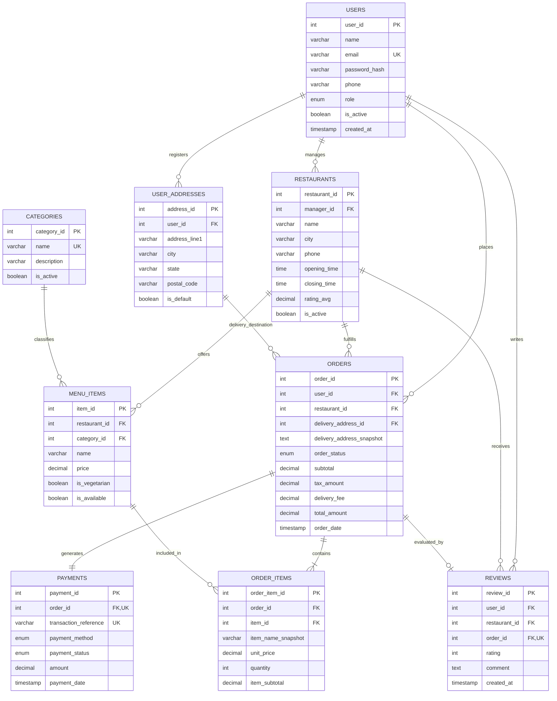

# Online Food Ordering System — DBMS Capstone Project Report
**Department of Computer Science & Engineering**
**Degree: Bachelor of Technology (B.Tech CSE)**

---

## Abstract
The **Online Food Ordering System** is a centralized, relational database-driven enterprise application designed to streamline meal ordering, restaurant catalog management, transactional order processing, and analytical reporting. Traditional food ordering systems frequently suffer from lack of transactional guarantees, price tampering vulnerabilities, and data anomalies resulting from unnormalized schemas. This project presents a 3NF normalized MySQL database architecture integrated with a Node.js/Express.js RESTful service tier and a React (Vite) presentation tier. Key highlights include atomic multi-table order placement under explicit ACID transactions, immutable historical price snapshotting, domain invariants (single-restaurant cart validation), automated rating recalculations via MySQL triggers, and pre-compiled analytical views.

---

## 1. Problem Statement
The proliferation of on-demand digital food delivery services necessitates robust database backends capable of handling concurrent transactions while preserving financial and operational consistency. Common failure modes in poorly architected systems include:
1. **Price Manipulation**: Trusting client-side cart totals instead of verifying live menu prices server-side.
2. **Historical Distortion**: Updating dish prices in a catalog inadvertently modifying past order receipts and sales records.
3. **Data Inconsistency / Incomplete Writes**: Server crashes mid-order leaving order headers without corresponding line items or unconfirmed payments.
4. **Relational Redundancy**: Comma-delimited line items or multi-valued columns that violate relational normal forms.

---

## 2. Objectives & Scope
* **Primary Objective**: Design and deploy a production-grade relational database schema adhering strictly to Third Normal Form (3NF) while implementing necessary historical snapshot denormalization.
* **Secondary Objective**: Implement a 3-tier full-stack architecture that showcases real-world DBMS operations:
  * Atomic multi-table transactions (`START TRANSACTION ... COMMIT / ROLLBACK`).
  * Role-Based Access Control (RBAC) across Customers, Restaurant Managers, and Administrators.
  * Real-time restaurant rating synchronization using database triggers.
  * Performance enhancement via B-Tree composite indexes and query execution planning (`EXPLAIN`).
  * 23+ operational and analytical SQL queries demonstrating complex multi-table joins, subqueries, group aggregations, and window ranking functions.

---

## 3. Existing System vs. Proposed System

| Dimension | Legacy / Naive Systems | Proposed Online Food Ordering System |
| :--- | :--- | :--- |
| **Data Storage** | Flat files, unnormalized spreadsheets, or loosely coupled document stores. | Fully normalized (3NF) relational database running on MySQL 8.0 InnoDB engine. |
| **Transaction Safety** | Auto-commit single writes; network failures create partial/orphaned records. | Explicit multi-statement ACID transactions; rolls back entire operation on error. |
| **Pricing Integrity** | Calculates totals in browser JavaScript; susceptible to client manipulation. | Server-authoritative calculation reading verified active database records. |
| **Price History** | Overwrites menu prices; corrupts past financial invoices. | Frozen historical snapshot pattern (`order_items.unit_price`). |
| **Rating Recalculation** | Repeated expensive $O(N)$ full table scans on every page load. | Automated database triggers (`AFTER INSERT / UPDATE / DELETE ON reviews`). |

---

## 4. System Architecture

```
+--------------------------------------------------------------------------+
|                            PRESENTATION TIER                             |
|          React 18 + Vite | Tailwind CSS | React Router | Axios           |
|  - Customer Portal (Catalog, Live Cart, Checkout, Order Tracking)        |
|  - Admin & Manager Suite (Analytics Dashboard, Menu CRUD, Order Monitor) |
+--------------------------------------------------------------------------+
                                    │
                                REST API
                            (JSON, Bearer JWT)
                                    ▼
+--------------------------------------------------------------------------+
|                            APPLICATION TIER                              |
|                          Node.js & Express.js                            |
|  [Security & Middleware]: CORS, Rate-Limiting, JWT & Role Guards (RBAC)  |
|  [Business Logic]: Cart Validator, Order State Machine, Tax Calculator   |
|  [Data Access Layer]: mysql2/promise Connection Pool & ACID Transactions |
+--------------------------------------------------------------------------+
                                    │
                          Parameterized SQL (InnoDB)
                                    ▼
+--------------------------------------------------------------------------+
|                             DATABASE TIER                                |
|                            MySQL 8.0 Engine                              |
|  - Normalized 3NF Tables (Foreign Keys, Cascade Policies, Constraints)   |
|  - B-Tree Composite Indexes for high-frequency queries                   |
|  - Database Views for reporting and aggregated metrics                   |
|  - Triggers for automatic restaurant rating recalculation                |
+--------------------------------------------------------------------------+
```

---

## 5. Entity-Relationship (ER) Diagram



---

## 6. Data Flow Diagrams (DFDs)

### Level 0: Context Diagram
```
              [Customer]
               │     ▲
  Credentials, │     │ Order Status,
  Cart, Order  │     │ Receipts
               ▼     │
       +-----------------------+
       |   Online Food         |
       |   Ordering System     |
       +-----------------------+
               │     ▲
  Menu Items,  │     │ Order Alert,
  Status Upd   │     │ Kitchen Queue
               ▼     │
          [Restaurant / Admin]
```

### Level 1: Core Process Breakdown
* **Process 1.0 (Authentication & Profile)**: Validates email uniqueness, verifies bcrypt hashes, mints JWT claims.
* **Process 2.0 (Catalog & Search Service)**: Queries indexed restaurants and active dishes by cuisine, city, and dietary preference.
* **Process 3.0 (Order & Transaction Processor)**: Validates single-restaurant invariant, computes server taxes/fees, begins ACID transaction, inserts `orders`, `order_items`, and `payments`.
* **Process 4.0 (Fulfillment & State Machine)**: Advances status (`CONFIRMED` $\to$ `PREPARING` $\to$ `OUT_FOR_DELIVERY` $\to$ `DELIVERED`). Auto-completes payments or initiates auto-refunds on cancellation.
* **Process 5.0 (Review & Trigger Synchronizer)**: Receives verified reviews; fires triggers updating restaurant averages.

---

## 7. Normalization Walkthrough

1. **First Normal Form (1NF)**:
   - Each field contains strictly atomic scalar values.
   - Repeating lists (e.g. food items within an order) are normalized into the separate table `order_items`.
   - Primary keys uniquely identify every row across all 9 tables.
2. **Second Normal Form (2NF)**:
   - Conforms to 1NF.
   - Contains no partial functional dependencies on composite candidate keys. In junction table `order_items`, attributes such as `quantity` and `unit_price` are fully functionally dependent on the entire primary key `order_item_id`.
3. **Third Normal Form (3NF)**:
   - Conforms to 2NF.
   - Contains zero transitive dependencies ($A \to B$ and $B \to C$). In `orders`, we store only `user_id` and `restaurant_id`. Non-key attributes of the customer (e.g. email, phone) or restaurant (e.g. city, opening hours) are not duplicated inside the order table.
4. **Deliberate Snapshot Denormalization**:
   - `order_items.unit_price` and `order_items.item_name_snapshot`: Freezes historical pricing at the time of purchase.
   - `orders.delivery_address_snapshot`: Preserves immutable legal delivery records even if customer later alters their saved profile addresses.

---

## 8. Conclusion & Future Enhancements

### Conclusion
The **Online Food Ordering System** successfully demonstrates that advanced relational database concepts—normalization, foreign key cascading, constraints, B-Tree indexing, triggers, views, and ACID transactions—can be seamlessly integrated into a modern web stack. By enforcing database invariants both at the schema level and through application middleware, the system guarantees high data integrity, tamper-proof calculations, and responsive user interfaces.

### Future Enhancements
1. **Geospatial Indexing**: Implementing MySQL GIS extensions (`ST_Distance_Sphere`, `Point`) to calculate exact delivery fees and driver dispatch based on GPS coordinates.
2. **WebSockets / Server-Sent Events (SSE)**: Replacing client polling with real-time push notifications for live delivery tracking.
3. **Automated Inventory Tracking**: Linking dish availability to ingredient batch inventories with auto-deduction triggers upon order placement.
